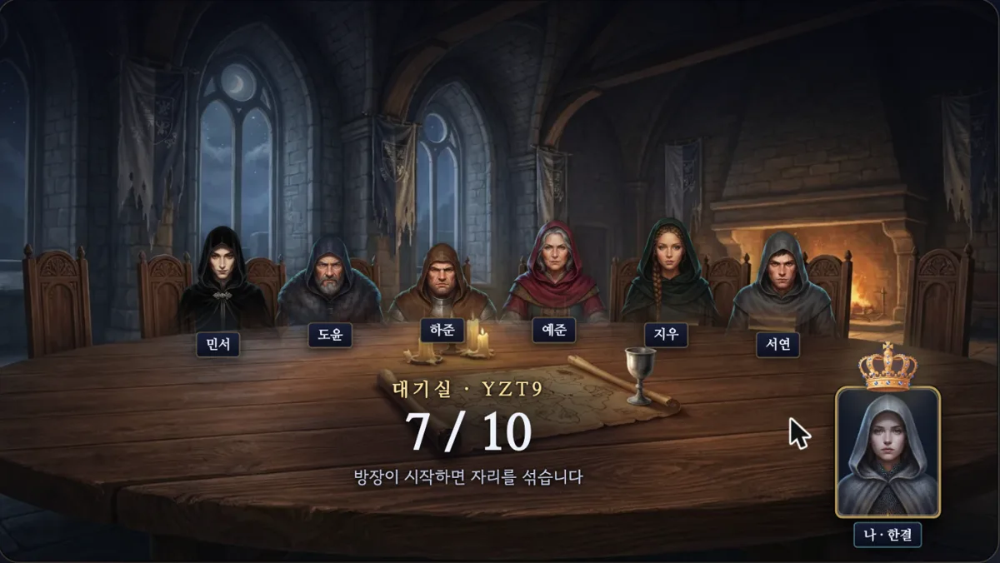

# 은빛 서약

방을 만들고 5~10명이 각자 폰으로 들어와 하는 숨은 역할 파티 게임.
단장이 원정대를 고르고, 모두 찬반을 내고, 원정대만 몰래 카드를 낸다. 다섯 원정 가운데 셋을 먼저 가져가는 쪽이 이기지만 마지막 지목이 남아 있다.

**하러 가기: https://res-avalon-fanproj.41ways.workers.dev/**



## 화면
처음 화면 → 방 목록(방 만들기 · 초대 코드로 들어가기) → 대기실 → 판 → 결과(같은 방으로 한 판 더)

- 대기실: 내 자리에서 탁자 건너편을 보는 장면. 들어오는 사람이 의자에 나타난다. 방장이 역할 구성 · 진실의 등불 · 토론 타이머 · 비공개를 정한다
- 판 시작: 장면 속으로 다가가며 자리를 섞고, 각자 화면에서 역할 카드를 뒤집는다
- 역할 · 아는 것 · 원정 카드 · 표 · 등불로 본 편은 그 사람 기기에만 간다. 서버가 판을 쥐고 각자 몫만 보낸다
- 표 공개 · 원정 공개는 연출이 끝나면 저절로 넘어간다
- 채팅은 언제나 화면 안에 있다(넓은 화면은 오른쪽 기둥, 폰은 아래 띠)
- 끊겨도 같은 기기로 다시 열면 자리를 잇는다. 돌아오지 않는 사람이 있으면 방장이 판을 접을 수 있다
- 한 기기로 돌려 하기: `local.html` (태블릿 하나를 돌려 쓰는 오프라인 판)

규칙과 역할은 [RULES.md](RULES.md).

## 만든 방식
- 서버: Cloudflare Workers + Durable Object 하나(허브의 다른 온라인 게임과 같은 짜임). 판 규칙은 `src/engine.js`, 방 · 목록 · 채팅은 `src/hub.js`
- 화면: `public/` 정적 파일. 빌드 없음. `public/themes.js` 에 이름 · 문구, `public/app.js` 가 온라인 화면
- 그림: Gemini로 새로 그렸다(`tools/grab.sh`, `tools/clip.sh` 로 받아 `public/art/raw/` 에 원본, 깃에는 안 올림)

```bash
npm install
node server.js          # http://localhost:8870
node test/sim.js 300    # 판 300번 · 비밀이 새지 않는지
node test/bots.js ABCD 6   # 방 ABCD 에 시험용 6명 앉히기
npx wrangler deploy
```

## 고지
비공식·비영리 팬 프로젝트다. 보드게임 『레지스탕스: 아발론』(Indie Boards & Cards)의 진행 방식을 바탕으로 했고, 이름 · 인물 · 그림은 새로 만들었다.
『레지스탕스: 아발론』 명칭과 상표의 권리는 원권리자에게 있다. 권리자께서 문제를 알려 주시면 바로 비공개로 돌리거나 지우겠다. 문의 gyolno2@naver.com
