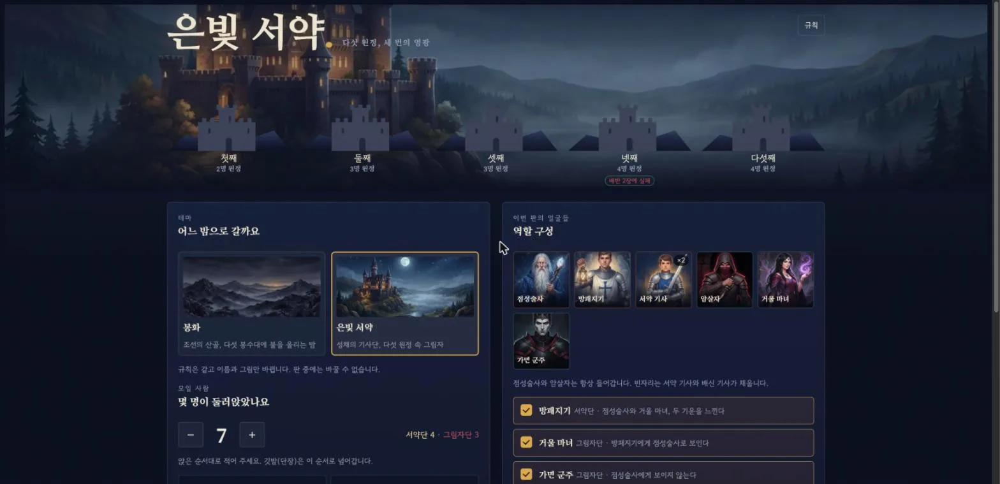

# 봉화 · 은빛 서약

태블릿 한 대를 돌려 가며 하는 숨은 역할 파티 게임. 5~10명.
대장이 원정대를 고르고, 모두 찬반을 내고, 원정대만 몰래 카드를 낸다. 다섯 원정 가운데 셋을 먼저 가져가는 쪽이 이긴다.

**플레이: https://41ways.github.io/res-avalon-fanproj/**

## 테마
설정 화면에서 고른다. 규칙은 같고 이름과 그림만 바뀐다.
- **봉화** — 조선의 산골, 다섯 봉수대에 불을 올리는 밤. 봉수대 대 먹구름
- **은빛 서약** — 성채의 기사단과 그 틈에 숨은 그림자단

규칙과 역할은 [RULES.md](RULES.md).

## 화면 방식
- 역할 확인: 자기 이름을 누르고 가림막을 걷은 뒤 본다. 확인하면 다시 가린다
- 찬반: 엄지로 동시에 공개(기본) 또는 돌려가며 몰래 입력 후 동시 공개
- 원정 카드: 대원에게 차례로 넘긴다. 카드 순서는 매번 섞이고, 선한 편은 실패 카드를 누를 수 없다
- 진행 상황은 브라우저에 저장돼 새로고침해도 이어진다

## 만든 방식
`index.html` 한 파일. 빌드 없음. 그림은 생성형 이미지(Gemini)로 새로 그렸다. `tools/crop.py` 는 그림 시트를 자르는 스크립트.

## 고지
비공식·비영리 팬 프로젝트다. 『레지스탕스: 아발론』(Indie Boards & Cards)의 진행 방식에서 영감을 받았고, 이름·인물·그림은 새로 만들었다.
권리자께서 문제를 알려 주시면 바로 내리겠다. 문의 gyolno2@naver.com
